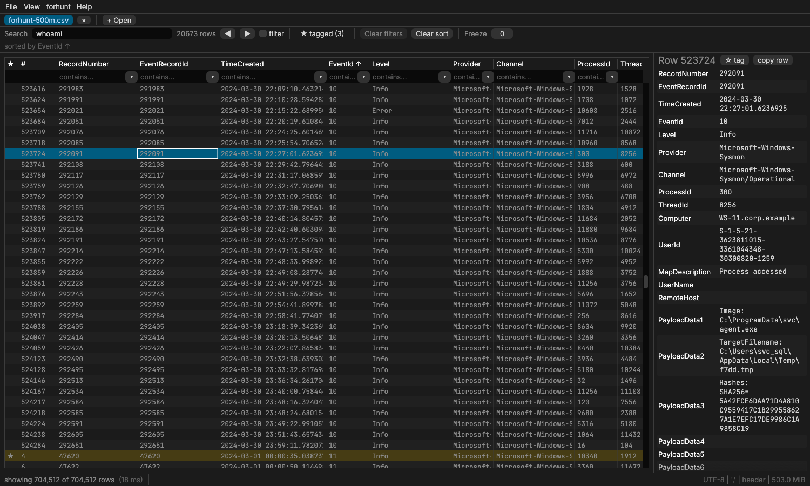
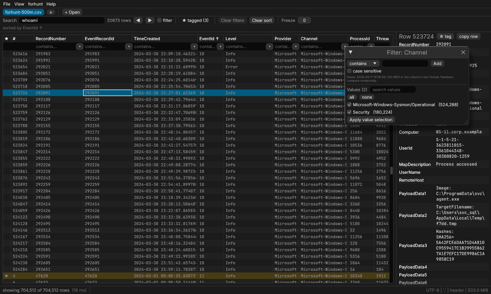

# forhunt-viewer

A native, very fast timeline and CSV viewer for forensic analysts. It opens
multi-GB CSV files (5-20 GB, tens of millions of rows) in seconds and
filters them interactively. It is the graphical companion of
[forhunt](https://github.com/0xRD/forensic-hunter).

It reads:
- **Windows event logs (`.evtx`), NTFS `$MFT` / `$UsnJrnl:$J`, or a whole
  evidence folder**, parsed by forhunt's own engine (built in, nothing to
  install) into one timeline;
- forhunt CSV (EvtxECmd layout plus `ForhuntId`);
- Eric Zimmerman tools output (EvtxECmd, MFTECmd, PECmd, ...);
- Hayabusa, plaso/psort l2tcsv, and any other CSV / TSV.



All data in the screenshots is synthetic (`tools/csv-gen`).

## Features

- **Open evidence directly.** Drop `.evtx` files, `$MFT` / `$J`, or a folder
  (File > *Open evidence folder…*): forhunt parses them in the background
  (cancellable) into a CSV identical to `forhunt parse -F csv`, which opens
  as one timeline sorted by `TimeCreated`. Files dropped together become one
  timeline. The CSV is cached (not written next to the evidence), so
  reopening is instant; File > *Export rows…* saves it, or a filtered part.
  The forhunt evidence path is set for you, so *Copy `forhunt show`
  command* works straight away. 56,930 events (67 MB, 12 logs) take 0.1 s.
- **Instant open.** The first rows show in well under a second, while a
  parallel, quote-aware pass indexes the file in the background. The index
  is cached, so reopening a 5 GB file takes under a second.
- **Bounded memory.** The file is never loaded as rows. The grid reads only
  the visible rows; the index is 2-7 % of the file size.
  - Sorting a long text column maps the file read-only while it resolves
    ties. The OS reports those pages as resident memory, but they are page
    cache and the OS can reclaim them; see D-013.
- **Filters.**
  - Per-column filter row ("contains").
  - Condition editor: equals, not equals, contains, not contains,
    begins/ends with, blank, not blank, in list / not in list (one value
    per line, e.g. a pasted IOC list), regex, `>` `>=` `<` `<=`, between
    (numbers and dates; `<=` and the end of `between` include the whole
    day, minute or second written, so `between 2024-03-01 and 2024-03-01`
    is that day).
  - Match all / any.
  - Excel-style value list with counts and search. It, and the cell menu's
    "= / ≠ this value", select exact values (case and spaces count).
  - Filter chips; clear all.
- **Global search** in every column, with match highlighting and next /
  previous (F3). Tick *only matches* to hide the rows without the search
  text.
- **Sorting.** Multi-column (click, shift-click), deterministic (ties keep
  file order).
- **Columns.** Show/hide, reorder, resize. *Freeze N cols* (toolbar, or
  right-click a header > *Freeze up to here*) pins the first N columns at
  the left while you scroll sideways.
- **Detail pane.** Every field of the selected row, including the extra
  fields of malformed rows. JSON cells (e.g. `Payload`) are pretty-printed.
  Copy cell / row / column.
- **Tags and notes** on rows; "tagged only" filter.
- **Bad rows** (wrong field count, broken quotes) are counted and can be
  shown. A malformed file never crashes the viewer.
- **Export** of the current view or tagged rows to CSV or JSONL (visible
  columns, display order).
- **Sessions.** Save and restore filters, columns, sort and tags as JSON.
- **Files.**
  - Tabs, drag and drop, recent files.
  - Encodings: UTF-8 (with or without BOM), UTF-16LE/BE, Windows-1252.
  - Delimiters `,` `;` tab `|`, auto-detected. When the header row was only a
    guess, the status bar says so; File > *Reopen with options…* sets the
    header and delimiter by hand.
  - Dates: day/month order is detected per column and can be set in the
    column menu. A range filter shows on its chip how many cells it could
    not read as dates or numbers, so rows are never left out silently.
- **Display time zone.** Times are converted for display only; the data
  stays as in the file. In date filters (`>`, `<`, between), a time typed
  without an offset means the display zone, like the times shown (a day
  is 23 or 25 hours across a DST change); `Z` or `+02:00` is taken as
  written. Text matching on time columns (filter row, contains, global
  search) matches the file's values (UTC for forensic tools): the filter
  chip and the search box say so in orange when the zone is not UTC.
- **Dark and light themes**, keyboard-friendly.
- **forhunt integration.** When a `ForhuntId` column is present:
  - copy `forhunt show <id> -p <evidence>` from a row's context menu;
  - export the tagged ids (one per line, TAB, note) for the forhunt skill
    report.



### Limits

- Line endings: LF and CRLF. Files with old Mac line endings (CR only) are
  read as one long row.
- Up to 4 294 967 295 rows per file.

### Forensically sound

- Inputs are opened read-only and never modified.
- Index caches, UTF-16 conversions, settings and sessions go to the OS
  cache/config directories or a location you choose, never next to the
  evidence:
  - Linux: `~/.cache/forhunt-viewer`;
  - macOS: `~/Library/Caches/forhunt-viewer`;
  - Windows: `%LOCALAPPDATA%\forhunt-viewer`.
- Converted UTF-16 / Windows-1252 files need disk space in the cache
  directory (UTF-16: up to the original size; Windows-1252 with many
  accented letters: up to twice).
- The cache stays under 20 GiB (oldest files are removed first), and
  *View > Clear index cache* empties it.
- A cached index is reused when the path, size, modification time and a
  sample of the content (first, middle and last 64 KiB) match. A file
  changed elsewhere in its middle, with size and mtime preserved, would
  need a cache clear.

## Install

Downloads are on the [Releases](https://github.com/0xRD/forhunt-viewer/releases)
page. Each file has a `.sha256`, and `SHA256SUMS` lists them all.

| OS | Package |
|---|---|
| macOS (Apple Silicon) | `forhunt-viewer-<v>-macos-arm64.dmg` |
| Windows x86_64 | `forhunt-viewer-<v>-windows-x86_64.msi` (installer) or `.zip` (portable) |
| Linux x86_64 | `forhunt-viewer-<v>-linux-x86_64.AppImage` or `.tar.gz` |

The builds are **not code-signed** (no Apple Developer ID or Windows
certificate yet):

- **macOS (Apple Silicon).** Drag the app to Applications. The app is not
  notarized, so the first launch is blocked ("Apple could not verify..."):
  open *System Settings > Privacy & Security*, click *Open Anyway* next to
  the forhunt-viewer message and confirm (macOS 15 and later no longer offer
  right-click > *Open* for this). Alternatively, after checking the SHA-256:
  `xattr -dr com.apple.quarantine /Applications/forhunt-viewer.app`.
  Intel Macs: build from source (below).
- **Windows.** SmartScreen may warn: *More info > Run anyway*.
- **Linux.** `chmod +x forhunt-viewer-*.AppImage`. The tarball holds the
  binary, a `.desktop` file and an icon.

Homebrew (Apple Silicon): `brew install --cask 0xrd/tap/forhunt-viewer`.

From source (Rust 1.97; the toolchain is pinned in `rust-toolchain.toml`):

```bash
cargo install --git https://github.com/0xRD/forhunt-viewer fhv-app
```

On Linux, building also needs `libxkbcommon-dev`, `libwayland-dev`,
`libx11-dev` and `libgl1-mesa-dev` (or your distribution's equivalents).

## "Open with"

forhunt-viewer adds itself to the *Open with* menu for CSV/TSV files and
Windows event logs (`.evtx`; also folders on macOS). It never becomes the
default application unless you choose it.

- **macOS.** Right-click a `.csv`, `.evtx` or folder > *Open With* >
  *forhunt-viewer*. (Finder learns about the app once it is in Applications
  and has been opened once.)
- **Windows (MSI).** Right-click a `.csv` / `.tsv` / `.evtx` > *Open with* >
  *forhunt-viewer*. To make it the default: *Choose another app* > tick
  *Always*.
- **Linux.** Install the `.desktop` file:

  ```bash
  install -Dm644 forhunt-viewer.desktop ~/.local/share/applications/forhunt-viewer.desktop
  install -Dm644 forhunt-viewer.png ~/.local/share/icons/hicolor/256x256/apps/forhunt-viewer.png
  ```

  Then use *Open With > forhunt-viewer* in your file manager. To make it the
  default: `xdg-mime default forhunt-viewer.desktop text/csv`.

Command line: `forhunt-viewer [PATH...]` (CSV/TSV files, `.evtx`, `$MFT`,
`$J` or evidence folders).

## Keyboard shortcuts

| Keys | Action |
|---|---|
| Ctrl+O | open files |
| Ctrl+W | close tab |
| Ctrl+F | global search |
| F3 / Shift+F3 | next / previous match |
| Ctrl+G | go to row (`#` column) |
| Arrows, PgUp/PgDn, Ctrl+Home/End | move the selection |
| Ctrl+C / Ctrl+Shift+C | copy cell / copy row as indented JSON (right-click a cell for tab-separated) |
| click / Shift+click a header | sort / add a sort column |
| right click | header and cell menus |
| Esc | cancel the running operation |

On macOS, Ctrl is Cmd.

## Performance

Measured on a 4-core cloud VM (Xeon 2.1 GHz, 15 GiB, virtio disk), warm
page cache unless noted. Details, commands and more results are in
[docs/PERF.md](docs/PERF.md).

| 5 GB file | hayabusa layout, 20.3 M rows | forhunt layout, 8.7 M rows |
|---|---:|---:|
| first rows on screen | 20-35 ms | 26-75 ms |
| row index (cold / warm) | 2.6 s / 1.3-1.9 s | 2.7 s / 1.7-1.9 s |
| column indexes | 3.8 s | 4.0 s |
| reopen with cached index | 0.45-0.66 s | 0.06-0.30 s |
| index size (rows + columns) | 362 MiB (6.7 %) | 202 MiB (3.8 %) |
| `in` / `not in` on an indexed column | 4-17 ms | 1-6 ms |
| `contains` on one text column | 0.55-1.0 s (then cached) | 0.5-2.0 s |
| global search | 0.6-0.8 s | 0.4 s |
| sort by time / indexed column | 0.17-0.32 s / 0.2 s | 0.02-0.08 s |
| sort by number | 2.2 s | 1.1 s |
| scrolling, frame CPU p99 (software OpenGL) | 11.3 ms | 10.1 ms |

Known slow case: a full sort of a long free-text column over 20 M rows takes
~11 s (it stays responsive and can be cancelled). The same sort on a filtered
view of 1 M rows takes 0.8 s. See docs/DECISIONS.md D-013.

## How it works (short)

- `crates/fhv-engine` is a headless library.
  - **Row index.** A parallel row scanner runs a CSV state machine for
    every possible starting state at once. It packs the states into one
    byte and skips non-special bytes 8 at a time.
  - **Index storage.** About 4 bytes per row.
  - **Column indexes.**
    - roaring bitmaps per value of low-cardinality columns;
    - parsed times plus a sort permutation for the main time column.
  - **Filters.** Cached bitmaps, combined with bitmap algebra.
  - **Scans.** Text columns are scanned in parallel, behind a regex
    prefilter.
  - **Tests.** Property-tested against naive implementations.
- `crates/fhv-app` is the egui/eframe application with a custom virtual
  grid. Its scroll position is a row index, so huge files scroll smoothly
  (measured: 20 M real rows, and 1 B synthetic rows in an early grid
  prototype).
- `tools/csv-gen` generates synthetic, seeded test data: forhunt / EvtxECmd,
  MFTECmd, Hayabusa, plaso layouts, and an edge-case suite.

More: [docs/DESIGN.md](docs/DESIGN.md),
[docs/DECISIONS.md](docs/DECISIONS.md) (every design decision, with
measurements), [docs/PERF.md](docs/PERF.md),
[docs/ROADMAP.md](docs/ROADMAP.md) and [CHANGELOG.md](CHANGELOG.md).

## Testing

Filters, sorts and exports are checked against an independent
implementation, not against the viewer itself: a Python oracle (its own CSV,
time and number parsing) recomputed about 105,000 queries on a real
two-host lab timeline (56,930 events, French-locale Windows) and on every
synthetic layout and edge case (quoted newlines, UTF-16, Windows-1252,
ragged rows): every operator on every column, with and without case
sensitivity, value lists, AND/OR/NOT trees, global search, sorts, tags and
export round trips, with no mismatch. Unit, property and UI tests
(egui_kittest) run in CI on Linux, macOS and Windows.

## Development

```bash
scripts/check.sh          # fmt, clippy -D warnings, all tests
scripts/check-gen.sh      # csv-gen output is deterministic (checksums)
cargo run --release -p csv-gen -- gen --layout forhunt --size 1G -o big.csv
cargo run --release -p fhv-bench -- index big.csv
cargo run --release -p fhv-bench -- query big.csv --ops bench/forhunt.ops
```

Test data is always generated. Never commit real evidence or logs.

## Licence

MIT OR Apache-2.0. Fonts: Inter and JetBrains Mono (SIL OFL 1.1). See
[THIRD-PARTY.md](THIRD-PARTY.md) for every bundled dependency.

forhunt-viewer is an independent project, inspired by the workflows of
timeline tools analysts already know. It contains no code or assets from
any of them.
