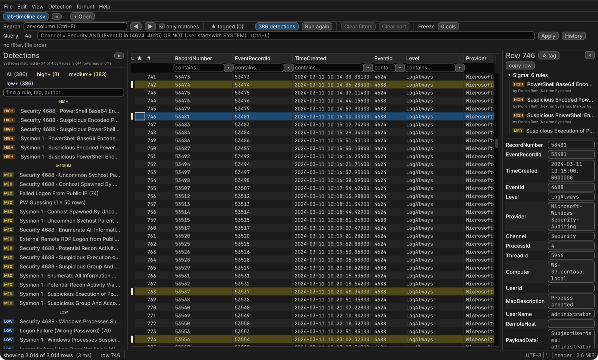
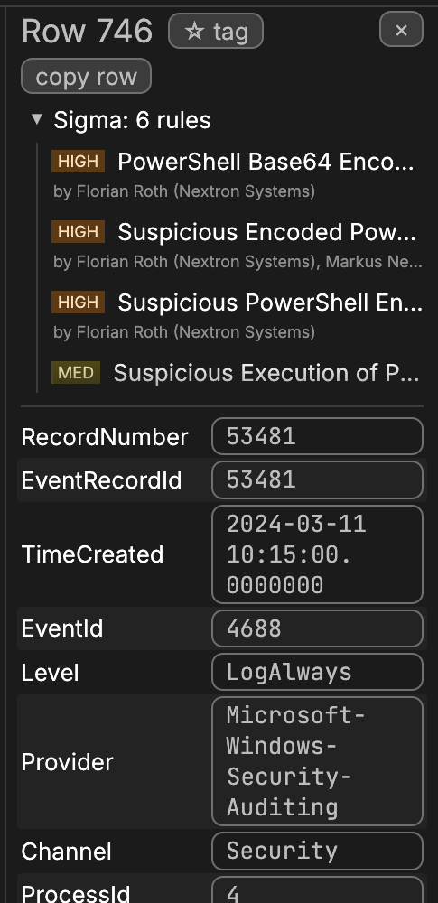
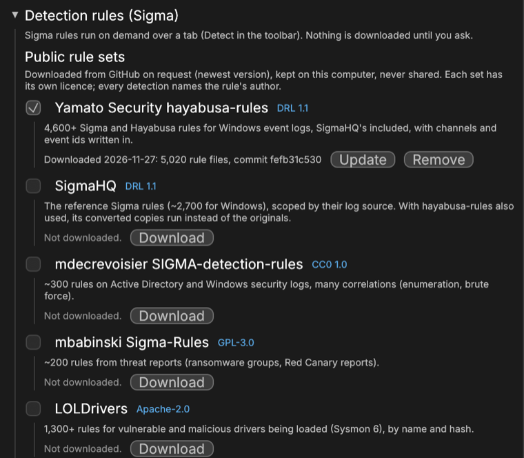

# forhunt-viewer

A fast timeline and CSV viewer for forensic analysts, with Sigma detection
built in. It opens multi-GB files in seconds and filters them as you type.
It is the graphical companion of
[forhunt](https://github.com/0xRD/forensic-hunter).



## What it opens

- **Evidence, parsed for you**: `.evtx`, `$MFT`, `$J`, prefetch, registry
  hives, `.ost` / `.pst`, or a whole collection folder, merged into one
  timeline.
- **CSV / TSV**: forhunt, Eric Zimmerman's tools (EvtxECmd, MFTECmd...),
  Hayabusa, plaso, or anything else.

## Highlights

- **Fast.** First rows in under a second on a 5 GB file, cached index for
  instant reopening, no RAM blow-up ([numbers](docs/PERF.md)).
- **Filters.** Per column, Excel-style value lists, or a query bar:
  `Channel = Security AND EventID in (4624, 4625)`.
- **Sigma detection.** *Detect* runs 4,000+ Sigma / Hayabusa rules over the
  timeline in seconds. Hits are marked by level, the panel filters to a rule,
  and the detail pane names the rules of each row.
- **Analyst tools.** Grouping, coloring rules, duplicates, tags and notes,
  time zones, copy as Markdown / HTML / CSV, export, sessions, themes.
- **Forensically sound.** Read-only. Nothing is ever written next to or into
  the evidence.

<p>
  
  
</p>

Rule sets (hayabusa-rules, SigmaHQ and others) are downloaded only when you
click *Download* in Settings, each under its own licence.

> **Antivirus / EDR:** rule files contain the strings they detect (attack
> tools, encoded PowerShell...), and some security products flag them.
> Download rules where that is expected. The viewer never runs anything
> they contain.

## Install

```bash
brew install --cask 0xrd/tap/forhunt-viewer      # macOS, Apple Silicon
```

Windows (`.msi` / `.zip`) and Linux (`.AppImage` / `.tar.gz`) builds are on
the [Releases](https://github.com/0xRD/forhunt-viewer/releases) page. They
are not code-signed: on macOS, allow the app once in *System Settings >
Privacy & Security*; on Windows, *More info > Run anyway*.

From source: `cargo install --git https://github.com/0xRD/forhunt-viewer fhv-app`.

## Learn more

- [Guide](docs/GUIDE.md): every feature, the query language, keyboard
  shortcuts, file formats, limits.
- [Performance](docs/PERF.md), [design](docs/DESIGN.md),
  [decisions](docs/DECISIONS.md), [changelog](CHANGELOG.md).

## Licence

MIT OR Apache-2.0. Bundled fonts: Inter and JetBrains Mono (SIL OFL 1.1).
See [THIRD-PARTY.md](THIRD-PARTY.md). Screenshots use synthetic data only.
